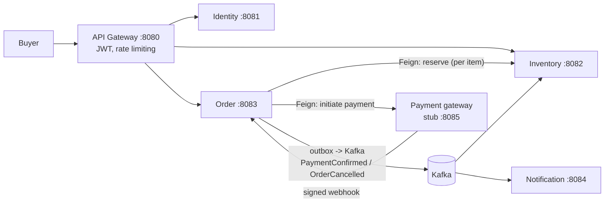

# FlashMart

Flash-sale infrastructure for brands. A single brand (think Puma or Nike) runs a time-boxed, limited-stock sale, and FlashMart handles the part that breaks: thousands of buyers racing for a few hundred units, with order, payment and inventory state that must end up consistent **without a distributed transaction**.

It is not a multi-vendor marketplace. It aggregates no independent sellers and moves no money to third parties, so there is no settlement or payout engine.

**What this repo is.** A learning and resume project, not a shipped product. Its point is to build one real problem (many buyers, a small fixed stock pool) with the backend tools that problem needs, and to be able to explain every decision. The labels below are used strictly: *designed* (on paper), *implemented*, *tested* (automated tests), *load-tested* (measured under load), *verified under failure* (a real failure was injected and watched). **One thing was measured that matters most: zero oversell in every load run (5,000 buyers against 500 units).** Two targets were **not** met: p99 under 500 ms, and 5,000 truly concurrent buyers. All runs were one run each on one laptop with a stub payment gateway, and runs vary a lot. See [Load test results](#load-test-results-measured-not-targets) and [Known limitations](#known-limitations).

## What this demonstrates

Each row says where the idea lives and how far it has been checked. The decision link goes to the reasoning in [`docs/decisions.md`](docs/decisions.md).

| Concept | Where it lives | Honest label | Decision |
|---|---|---|---|
| Compare-and-set on order status (the loser of a race knows it lost) | Order: every `orders.status` write | Implemented, tested (races on real Postgres: webhook vs expiry sweep) | [decisions.md](docs/decisions.md#decision-order-service-is-the-sole-authority-on-an-orders-fate-every-ordersstatus-write-is-a-compare-and-set) |
| One-payment invariant (one payment per order, extras refunded) | Order: webhook handler, `refunds` table | Implemented, tested. The refund *worker* is **not built**; the real payment gateway (Razorpay Clone) is not built, so its behaviours are designed, not verified | [decisions.md](docs/decisions.md#decision-an-order-keeps-exactly-one-payment-every-other-captured-payment-is-refunded), [decisions.md](docs/decisions.md#decision-refunds-are-issued-through-a-refunds-command-outbox-table-not-a-direct-call) |
| Transactional outbox and Kafka at-least-once, idempotent consumers | Order outbox relay, Inventory's two consumers | Implemented, tested on an embedded broker, verified under failure once on real processes (Kafka paused, duplicate event, Inventory down; earlier build) | [decisions.md](docs/decisions.md#decision-day-6-webhook-one-payment-edge-cases-paymentconfirmed-outbox-relay), [decisions.md](docs/decisions.md#decision-day-7-inventory-consumers-late-reservation-cleanup-expiry-sweep-and-its-index) |
| Reserve write path: one atomic conditional `UPDATE`, `READ COMMITTED` | Inventory `reserve` | Implemented, tested, raced, load-run on one laptop | [decisions.md](docs/decisions.md#decision-reserve-write-path-read-committed-one-atomic-conditional-update-one-short-transaction) |
| Circuit breaker, retries and derived deadlines | Order's payment step | Implemented, tested; verified under failure against the stub on an earlier build. Not load-tested against a real gateway | [decisions.md](docs/decisions.md#decision-day-5-payment-step-resilience-and-derived-deadlines), [decisions.md](docs/decisions.md#decision-deadlines-and-leases-are-derived-from-the-timeouts-they-race-never-picked) |
| Expiry sweep (orders left unpaid) | Order | Implemented, tested (raced against the webhook), verified under failure once | [decisions.md](docs/decisions.md#decision-day-7-inventory-consumers-late-reservation-cleanup-expiry-sweep-and-its-index) |
| Stale-reservation reconciler (a late reservation after a timed-out reserve call) | Inventory | Implemented, tested, demonstrated once on real processes with the late reservation forced | [decisions.md](docs/decisions.md#decision-day-9-inventory-stale-reservation-reconciler) |
| Gateway: JWT check, signed buyer id, Redis rate limiter that **fails open** | api-gateway | Implemented, tested, smoke-run on real processes, load-run (see limitations) | [decisions.md](docs/decisions.md#decision-day-8-auth-gateway-identity-rate-limiting-browse) |
| Config server (Git backend, local fallback) | config-server | Implemented, tested, smoke-run once | [decisions.md](docs/decisions.md#decision-day-9-part-0-config-server-spring-cloud-config-git-backend-public-repo-local-fallback) |
| Metrics (Prometheus, Grafana, one dashboard) | each service's own port | Implemented, tested, smoke-run once | [decisions.md](docs/decisions.md#decision-day-9-part-b-observability-prometheus-grafana-one-dashboard-as-files) |

Also in the repo: open-in-view off with the pool wait counted in the order deadline ([decisions.md](docs/decisions.md#decision-day-9-part-f-open-in-view-off-and-the-pool-wait-in-the-created-deadline)), the Feign upgrade and the Inventory start-up warm-up ([decisions.md](docs/decisions.md#decision-day-9-cold-start-fixes-feign-upgrade-inventory-warm-up-before-the-port)), and the Gateway's own lock-free rate-limiter script ([decisions.md](docs/decisions.md#decision-day-9-the-gateways-own-rate-limiter-script-lock-free)).

---

## The problem

- **Scarcity + concurrency:** many simultaneous purchase attempts against one hot `flash_sale_items` row.
- **Multi-item orders:** one order can hold several products from the same sale, so reservation must be all-or-nothing.
- **Payment across a network boundary:** Order calls a payment service over HTTP (OpenFeign) and learns the outcome later through a signed webhook.
- **Partial failure everywhere:** crashes between a DB commit and a Kafka publish, lost webhooks, duplicate deliveries, client retries.

## Architecture

Four Spring Boot business services (Identity, Inventory, Order, Notification), a gateway, a Eureka server, a config server and a payment stub. Each business service owns its own database. No service reads another's DB, and cross-service references are plain IDs or events, never foreign keys. Boundaries are drawn by traffic shape (hot/bursty vs cold) and failure blast radius, not by domain nouns.



| Service | Owns | Why it is separate |
|---|---|---|
| **API Gateway** | nothing (no DB) | Stateless routing, JWT at the edge, coarse rate limiting. `/internal/**` is never routable. |
| **Order** | `orders`, `order_items`, `refunds`, `outbox` | Sole authority on an order's fate. Hot and bursty. |
| **Inventory** | `flash_sales`, `flash_sale_items`, `stock_reservations`, `products` | Holds the most contended row, isolated so contention cannot starve other services. |
| **Identity** | `brands`, `users`, `api_keys`, `outbox` | Cold, low-volume auth traffic. |
| **Notification** | `notification_log`, `brand_contacts`, `buyer_contacts` | Cold and batch-tolerant. Keeps its own contact caches, so no runtime dependency on Identity. |
| **Payment gateway** | payment state | A clearly labelled **stub** stands in for the separate Razorpay Clone project. |

## The purchase flow

1. Buyer calls `POST /api/orders` with a JWT, an `Idempotency-Key`, a flash sale id and items.
2. Order inserts the order (`CREATED`) and all its items up front, then calls Inventory's `reserve` once per item.
3. Inventory runs one short local transaction per reserve: liveness check against the **database clock**, a conditional stock decrement, and a reservation insert guarded by `UNIQUE(order_id, flash_sale_item_id)`.
4. After every item is reserved, Order sets the amount and initiates payment (idempotency key derived from the order id). The gateway answers `202`, and the order moves to `PENDING_PAYMENT`.
5. The gateway later sends a **signed webhook**. Order verifies the signature and applies a compare-and-set to `PAID`, writing a `PaymentConfirmed` outbox row in the same transaction.
6. The outbox relay publishes to Kafka. Inventory confirms the reservations.
7. If anything fails, Order moves to a terminal failure state and writes `OrderCancelled{reason}`. Inventory releases the stock **asynchronously**, and nothing waits on the release.

### Order state machine

Two transient states (`CREATED`, `PENDING_PAYMENT`) lead to five terminal states: `PAID`, `PAYMENT_FAILED`, `ORDER_EXPIRED`, `PAYMENT_UNAVAILABLE`, `RESERVATION_FAILED`.

Every write to `orders.status` is a **compare-and-set** (conditional update plus a rows-affected check). The request thread, the expiry sweep, the webhook handler and the circuit-breaker path all race on one row, and the loser knows it lost.

## Key design decisions

Full context and trade-offs for each live in [`docs/decisions.md`](docs/decisions.md).

- **Reserve runs at `READ COMMITTED` with one atomic conditional `UPDATE`** (`WHERE available_stock >= ? AND <liveness>`) as the stock decrement. Liveness is judged on the DB clock in the same statement.
- **Idempotency is enforced by the database, not by code checks:** `UNIQUE(buyer_id, idempotency_key)` for orders, `UNIQUE(order_id, flash_sale_item_id)` for reservations, a partial unique index for one live-or-paid order per buyer per sale.
- **Reserve's evaluation order is contractual.** An existing reservation is returned *before* the liveness and stock gates, so a retry arriving after the sale ends still succeeds instead of wrongly cancelling the order.
- **Business outcomes are HTTP 200** (`RESERVED`, `OUT_OF_STOCK`, `SALE_NOT_LIVE`, ...). A non-2xx means something upstream is wrong, so it can alert without tripping the circuit breaker during a drop.
- **Transactional outbox** for `PaymentConfirmed` and `OrderCancelled`, so a DB commit and a Kafka publish can never come apart.
- **Kafka is at-least-once.** Every consumer is idempotent via a unique constraint or a state-guarded write. There is no claimed exactly-once guarantee.
- **One-payment invariant:** an order keeps exactly one payment, and any other captured payment is refunded via a `refunds` row written in the same transaction as the failed CAS.
- **No `saga_state` table.** Orchestration state lives on `orders`, because a second copy would diverge from the four independent writers of `orders.status`.
- **Money crosses every boundary as a JSON string** (`"3999.00"`), never a bare number.
- **Auth:** HS256 JWT with a short-lived access token and a rotating refresh token (Postgres). The gateway sends a signed identity header downstream.

## Tech stack

Java 21, Spring Boot 4.1.1 (Spring Cloud 2025.1.3), Spring Cloud Gateway, OpenFeign, Resilience4j, PostgreSQL, Flyway, Redis, Kafka, Docker, Gatling (load testing), Prometheus + Grafana.

## Repository layout

```
FlashMart/
├── config-server/          # Spring Cloud Config (Git backend), port 8888
├── eureka-server/          # discovery for the Gateway only, port 8761
├── api-gateway/            # JWT, signed buyer id, rate limiter, port 8080
├── identity-service/       # signup/login, JWT, refresh tokens, port 8081
├── inventory-service/      # flash sales, stock, reservations, port 8082
├── order-service/          # orders, state machine, webhook, outbox, port 8083
├── notification-service/   # receipts / cancellation emails, port 8084 (consumers not built)
├── payment-stub/           # stands in for the payment gateway, port 8085
├── load-tests/             # Gatling simulations and helper scripts
├── monitoring/             # Prometheus config, Grafana dashboard as files
├── scripts/seed/           # seed data, resettable to a live sale
├── docker-compose.yml      # Redis, Kafka, Prometheus, Grafana
├── docs/
│   ├── architecture.md     # the design and the status (what is built / tested)
│   ├── decisions.md        # decision log
│   ├── requirements.md     # FR-* / NFR-* / RZP-* requirement IDs
│   ├── development.md      # local setup details and load-test commands
│   └── testing.md          # evidence: every manual run, with numbers
└── CLAUDE.md               # working agreement for the AI coding agent
```

When documents disagree, the order of authority is `docs/decisions.md`, then `docs/architecture.md`, then `docs/requirements.md`, then `CLAUDE.md`.

## Running locally

**Last followed on 2026-11-09**, in a fresh `git clone` of `main` (JDK 25.0.2, PostgreSQL 18.6, Docker 29.9.2, Windows 11), up to one successful order through the Gateway (`201 PENDING_PAYMENT`, then `PAID` in the database a few seconds later). Not re-run that day: step 2 (the four databases already existed; only the quoting of the `CREATE DATABASE` command was checked on a throwaway name), step 3 (Redis and Kafka were already running from compose), the Gateway's 30 s wait (not timed), the tests and the load tests (their counts and numbers come from earlier runs recorded in `docs/testing.md`). It has not been followed on macOS or Linux.

Everything below is run from a Git Bash (or any POSIX) shell at the repo root. The helper scripts are bash.

### Prerequisites

| Need | Version / note |
|---|---|
| JDK | 21 or newer (every `pom.xml` sets `java.version` 21). Spring Boot is 4.1.1. |
| Maven | Not needed: each module has its own `./mvnw`. |
| PostgreSQL | One local instance on `localhost:5432`, with `psql` on the PATH. The author used 18. The **compose file's `postgres` service is not used** (it publishes 5432 and clashes with a local one). |
| Docker | For Redis 7, Kafka (`apache/kafka:4.3.1`) and, optionally, Prometheus and Grafana, all via `docker-compose.yml`. |
| Python 3 | Only for the load-test helper scripts and the smoke test below (standard library only). |
| Internet | The config server clones the public `flashmart-config` repo when it starts (see [Config repo](#config-repo)). |

### 1. Environment

```bash
cp .env.example .env
# edit .env: set DB_USERNAME, DB_PASSWORD, PAYMENT_WEBHOOK_SECRET,
# JWT_SECRET, GATEWAY_SIGNING_SECRET (two DIFFERENT values, each 32+ characters) and GRAFANA_ADMIN_PASSWORD
set -a; . ./.env; set +a      # Spring does not read .env: export it into the shell that starts each service
```

Never commit `.env`. Every variable the stack reads is listed in `.env.example`. `docker compose` refuses to start **any** service unless `DB_USERNAME`, `DB_PASSWORD` and `GRAFANA_ADMIN_PASSWORD` are set (it checks the whole file).

### 2. Create the four databases (once)

The services need four empty databases whose names contain hyphens. On your local Postgres:

```bash
export PGPASSWORD="$DB_PASSWORD"
for db in identity-service inventory-service order-service notification-service; do
  psql -h localhost -U "$DB_USERNAME" -d postgres -c "CREATE DATABASE \"$db\""
done
```

(`scripts/docker/postgres-init/01-create-databases.sql` has the same four statements.) Tables are created by each service's Flyway migrations the first time it starts.

### 3. Infrastructure

```bash
docker compose up -d redis kafka          # wait until `docker compose ps` shows both healthy
docker compose up -d prometheus grafana   # optional: Prometheus :9090, Grafana :3000 (user admin)
```

### 4. Build the jars

```bash
for m in config-server eureka-server api-gateway identity-service inventory-service order-service payment-stub notification-service; do
  (cd $m && ./mvnw -q -DskipTests package) || break
done
```

On JDK 25 the build prints harmless `sun.misc.Unsafe` warnings from Lombok.

**Rebuild all jars before a load run.** Stale jars in `target/` once almost invalidated a run ([`docs/development.md`](docs/development.md)).

### 5. Start the services, in this order

Each in its own shell (with the `.env` values exported, step 1), from the repo root:

| # | Service | Port | Command |
|---|---|---|---|
| 1 | config-server | 8888 | `java -jar config-server/target/config-server-*.jar` |
| 2 | eureka-server | 8761 | `java -jar eureka-server/target/eureka-server-*.jar` |
| 3 | identity-service | 8081 | `java -jar identity-service/target/identity-service-*.jar` |
| 3 | inventory-service | 8082 | `java -jar inventory-service/target/inventory-service-*.jar` |
| 3 | order-service | 8083 | `java -jar order-service/target/order-service-*.jar` |
| 3 | payment-stub | 8085 | `java -jar payment-stub/target/payment-stub-*.jar` |
| 4 | api-gateway | 8080 | `java -jar api-gateway/target/api-gateway-*.jar` |

Each business service takes about 25 to 35 s to start (cold, with Flyway on its first run). (`notification-service`, port 8084, is not needed: its consumers are not built.)

- The **config server is optional** for every client: if it is down a service starts on its own local `application.yml` and logs `CONFIG SOURCE: local fallback`.
- The **Gateway finds services only through Eureka**. It needs about **30 s after Order starts** before it can route to it; until then it answers `503 SERVICE_UNAVAILABLE`. Stop services gracefully (not a hard kill) in a demo, because Eureka can take a while to drop a dead one.
- Start the Gateway **last**.

### 6. Seed

With Identity, Inventory and Order started once (so Flyway has created the tables):

```bash
bash scripts/seed/seed.sh
```

This puts 1 brand, 3 products and one **live** sale in the databases (sale 1, item 1 = product 1, 500 units) and empties Order's tables. The sale window is 24 hours from the seed; re-run the script when it has passed. The seeded buyers cannot log in (placeholder password), so the smoke test signs up a new one.

### 7. Smoke test: one order through the Gateway

```bash
# make payments end PAID (the stub starts with auto-webhooks OFF and forgets this on restart)
curl -s -X POST http://127.0.0.1:8085/admin/auto-webhook -H 'Content-Type: application/json' -d '{"status":"SUCCESS"}'

# sign up and log in (the Gateway allows 1 auth request per second per IP)
curl -s -X POST localhost:8080/api/auth/signup -H 'Content-Type: application/json' \
  -d '{"name":"Smoke Buyer","email":"smoke@example.test","password":"a-long-test-password"}'
TOKEN=$(curl -s -X POST localhost:8080/api/auth/login -H 'Content-Type: application/json' \
  -d '{"email":"smoke@example.test","password":"a-long-test-password"}' | python -c 'import sys,json;print(json.load(sys.stdin)["accessToken"])')

# browse, then order 1 unit of product 1 in sale 1
curl -s -H "Authorization: Bearer $TOKEN" 'localhost:8080/api/flash-sales?page=0'
curl -s -X POST localhost:8080/api/orders -H "Authorization: Bearer $TOKEN" \
  -H 'Content-Type: application/json' -H 'Idempotency-Key: smoke-1' \
  -d '{"flashSaleId":1,"items":[{"productId":1,"quantity":1}]}'
```

Expect `201` with status `PENDING_PAYMENT`; a moment later the stub's signed webhook moves it to `PAID`.

### Run the tests

```bash
set -a; . ./.env; set +a
bash load-tests/reset-run.sh              # empties leftover load-run rows; some tests count whole tables
docker compose up -d redis                # the Gateway's rate-limiter tests need Redis (and Docker)
for m in config-server eureka-server api-gateway identity-service inventory-service order-service payment-stub notification-service; do
  (cd $m && ./mvnw test) || break
done
```

The tests run against the local Postgres in rolled-back transactions; no Kafka container is needed (an in-JVM embedded broker is used). Last full run: **686 tests, 0 failures, 0 errors, 0 skipped** (config-server 1, eureka-server 2, identity 119, inventory 137, order 319, notification 29, payment-stub 22, api-gateway 57), run once, 2026-11-09, one laptop (`docs/testing.md`).

### Run the load tests

`PlaceOrders` (Gatling) sends one order per buyer through the Gateway. The full step list (test buyers, tokens that live 15 minutes, the stub's auto-webhook, the checks to run within 6 minutes) is in [`docs/development.md`](docs/development.md#running-the-order-load-test-placeorders-day-9-part-c). Short form:

```bash
bash scripts/seed/seed.sh && bash load-tests/create-users.sh && bash load-tests/make-tokens.sh
cd load-tests && ../order-service/mvnw gatling:test \
  -Dgatling.simulationClass=com.flashmart.load.PlaceOrders -Dbuyers=5000 -DrampSeconds=10
cd .. && bash load-tests/verify.sh && bash load-tests/check-orders.sh
```

### Config repo

The config server serves values from a separate, public repo, `flashmart-config` (`https://github.com/akshxnsh/flashmart-config`). A fresh clone of this repo matches the author's setup **only if the commits in that repo are pushed**. Each client also has a local fallback copy of the same values; whether the two have drifted is not checked automatically.

### Ports

Config server 8888, Eureka 8761, Gateway 8080, Identity 8081, Inventory 8082, Order 8083, Notification 8084, payment stub 8085 (127.0.0.1 only), Prometheus 9090, Grafana 3000, Redis 6379, Kafka 9092.

## Load test results (measured, not targets)

One run each, one laptop (load tool, all services, Postgres and Docker on the same machine), stub payment gateway, one Kafka broker. Details and commands: [`docs/testing.md`](docs/testing.md). The targets are zero oversell under 5,000 concurrent requests and p99 under 500 ms; they are **not** met on this setup.

| Run (5,000 buyers over 10 s, 500 units) | Sold | Oversell | Gatling p99, answered only | Order p99, server side | Refused at the port |
|---|---|---|---|---|---|
| Part D R2 (warmed JVMs) | 500 | none | 12,374 ms | 12.66 s | 2,899 |
| R2F (fresh JVMs, before the cold-start fixes) | 0 | none | 20,301 ms | 7.94 s | 3,261 |
| R2 re-run (final build, fresh JVMs plus a 51-order gate) | 500 | none | 6,022 ms | 0.90 s | 3,978 |
| R2fix (Gateway's lock-free rate-limiter script; fresh JVMs plus the gate) | 500 | none | 31,339 ms | 9.77 s | 947 |

**Runs vary a lot** (Redis timeouts 28 against 758 between two runs of the same build), so one run per row proves
little.

**Refused buyers.** Diagnosis in part: the Gateway's event loops were seen held on a lock in the rate limiter's
script. With that lock removed, fewer buyers were refused in one run, but the ones let in waited far longer. That the
lock caused the refusals is not proven.

**p99 gap.** Why the buyer-side p99 is far above the server-side one is not explained.

## Known limitations

- **The payment gateway is a stub.** The real Razorpay Clone is a separate project. Its required behaviours (idempotent initiate and refund, status lookup, signed webhooks) are specified here but not verified against it.
- **Brands, flash sales and stock are seeded.** There is no brand-side API. Sale creation and editing, the "frozen once live" rules, and API-key auth exist only in the design (the `api_keys` schema exists, but no code path uses it).
- **Design-only components:** payment reconciliation sweep, Identity outbox events and the contact-cache backfill, outbox cleanup job.
- **No dead-letter topic.** A malformed Kafka message is skipped with an ERROR log. A temporary failure is retried and never skipped.
- **A late reservation after a timed-out reserve call** (Version B) is released by Inventory's stale-reservation reconciler, but only after about 10 minutes at best (threshold 570.5 s + one 60 s pass), and later when many stale rows it cannot act on are waiting (its cursor wraps around about every N / 50 passes) or an order it asks about keeps failing (retried after the wrap); until then that unit cannot be sold. The reconciler is tested and was demonstrated once on one laptop with the ordering forced; how often this happens under real overload is not measured (285 late commits in one 5,000-buyer run, all released by timing).
- **A cold Inventory is warmed only in part.** A start-up warm-up runs the reserve path before the port opens. It removed the calls over Order's 2 s limit in 3 of 3 cold test runs, but the first requests are still slower than on a warm service (cold p99 1.25 to 1.62 s against 0.80 to 0.85 s), because the web layer cannot be warmed before the port is open. Why a cold JVM is slow is not profiled. Each start skips 20 ids of the reservation id sequence. Measured on one laptop only.
- **One accepted exception to the one-payment invariant:** a second captured payment can escape correction only if initiate idempotency fails to dedupe, a webhook is separately lost, *and* the order reaches `PAID`. Three rare failures must stack.
- **An early webhook** (arriving while the order is still `CREATED`) is answered non-2xx so the gateway retries. This depends on the gateway retrying long enough.
- **Rate limiting fails open if Redis is down**, and the browse endpoint is not rate limited.
- **Metrics and `/actuator/env` are exposed on each service's own port with no authentication** (never routed through the Gateway, but anyone who can reach a service port can read them). Secrets show as `******`; this is for local use only.
- **Throughput is not where the targets are.** In the latest 5,000-buyer run (after the rate limiter's lock was removed), 947 buyers were refused at the Gateway's port, 118 got a 503 and the answered p99 was 31.3 s (target 500 ms). The previous run had 3,978 refused and a p99 of 6.0 s. One run each, one laptop. Neither the refusals nor the long waits are fully explained.
- **A buyer cannot start a new order** while an unpaid one is open, until it pays or expires.

## Documentation

- [`docs/architecture.md`](docs/architecture.md): current design (source of truth)
- [`docs/decisions.md`](docs/decisions.md): every architectural decision with context, options and trade-offs
- [`docs/requirements.md`](docs/requirements.md): functional and non-functional requirements
