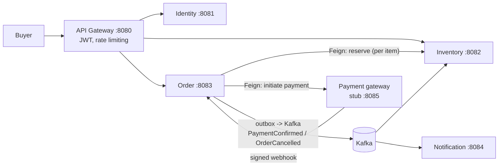

# FlashMart

Flash-sale infrastructure for brands. A single brand (think Puma or Nike) runs its own time-boxed, limited-stock sale, and FlashMart handles the part that breaks: thousands of buyers racing for a few hundred units, with order, payment and inventory state that must end up consistent **without a distributed transaction**.

It is not a multi-vendor marketplace. It aggregates no independent sellers and moves no money to third parties, so there is no settlement or payout engine.

---

## The problem

- **Scarcity + concurrency:** many simultaneous purchase attempts against one hot `flash_sale_items` row.
- **Multi-item orders:** one order can hold several products from the same sale, so reservation must be all-or-nothing.
- **Payment across a network boundary:** Order calls a payment service over HTTP (OpenFeign) and learns the outcome later through a signed webhook.
- **Partial failure everywhere:** crashes between a DB commit and a Kafka publish, lost webhooks, duplicate deliveries, client retries.

## Architecture

Four Spring Boot services plus a gateway, each owning its own database. No service reads another's DB, and cross-service references are plain IDs or events, never foreign keys. Boundaries are drawn by traffic shape (hot/bursty vs cold) and failure blast radius, not by domain nouns.



| Service | Owns | Why it is separate |
|---|---|---|
| **API Gateway** | nothing (no DB) | Stateless routing, JWT at the edge, coarse rate limiting. `/internal/**` is never routable. |
| **Order** | `orders`, `order_items`, `refunds`, `outbox` | Sole authority on an order's fate. Hot and bursty. |
| **Inventory** | `flash_sales`, `flash_sale_items`, `stock_reservations`, `products` | Holds the most contended row, isolated so contention cannot starve other services. |
| **Identity** | `brands`, `users`, `api_keys`, `outbox` | Cold, low-volume auth traffic. |
| **Notification** | `notification_log`, `brand_contacts`, `buyer_contacts` | Cold and batch-tolerant. Keeps its own contact caches, so no runtime dependency on Identity. |
| **Payment gateway** | payment state | A clearly labelled **stub** stands in for the separate Razorpay Clone project. |

## The purchase flow

1. Buyer calls `POST /api/orders` with a JWT, an `Idempotency-Key`, a flash sale id and items.
2. Order inserts the order (`CREATED`) and all its items up front, then calls Inventory's `reserve` once per item.
3. Inventory runs one short local transaction per reserve: liveness check against the **database clock**, a conditional stock decrement, and a reservation insert guarded by `UNIQUE(order_id, flash_sale_item_id)`.
4. After every item is reserved, Order sets the amount and initiates payment (idempotency key derived from the order id). The gateway answers `202`, and the order moves to `PENDING_PAYMENT`.
5. The gateway later sends a **signed webhook**. Order verifies the signature and applies a compare-and-set to `PAID`, writing a `PaymentConfirmed` outbox row in the same transaction.
6. The outbox relay publishes to Kafka. Inventory confirms the reservations.
7. If anything fails, Order moves to a terminal failure state and writes `OrderCancelled{reason}`. Inventory releases the stock **asynchronously**, and nothing waits on the release.

### Order state machine

Two transient states (`CREATED`, `PENDING_PAYMENT`) lead to five terminal states: `PAID`, `PAYMENT_FAILED`, `ORDER_EXPIRED`, `PAYMENT_UNAVAILABLE`, `RESERVATION_FAILED`.

Every write to `orders.status` is a **compare-and-set** (conditional update plus a rows-affected check). The request thread, the expiry sweep, the webhook handler and the circuit-breaker path all race on one row, and the loser knows it lost.

## Key design decisions

Full context and trade-offs for each live in [`docs/decisions.md`](docs/decisions.md).

- **Reserve runs at `READ COMMITTED` with one atomic conditional `UPDATE`** (`WHERE available_stock >= ? AND <liveness>`) as the stock decrement. Liveness is judged on the DB clock in the same statement.
- **Idempotency is enforced by the database, not by code checks:** `UNIQUE(buyer_id, idempotency_key)` for orders, `UNIQUE(order_id, flash_sale_item_id)` for reservations, a partial unique index for one live-or-paid order per buyer per sale.
- **Reserve's evaluation order is contractual.** An existing reservation is returned *before* the liveness and stock gates, so a retry arriving after the sale ends still succeeds instead of wrongly cancelling the order.
- **Business outcomes are HTTP 200** (`RESERVED`, `OUT_OF_STOCK`, `SALE_NOT_LIVE`, ...). A non-2xx means something upstream is wrong, so it can alert without tripping the circuit breaker during a drop.
- **Transactional outbox** for `PaymentConfirmed` and `OrderCancelled`, so a DB commit and a Kafka publish can never come apart.
- **Kafka is at-least-once.** Every consumer is idempotent via a unique constraint or a state-guarded write. There is no claimed exactly-once guarantee.
- **One-payment invariant:** an order keeps exactly one payment, and any other captured payment is refunded via a `refunds` row written in the same transaction as the failed CAS.
- **No `saga_state` table.** Orchestration state lives on `orders`, because a second copy would diverge from the four independent writers of `orders.status`.
- **Money crosses every boundary as a JSON string** (`"3999.00"`), never a bare number.
- **Auth:** HS256 JWT with a short-lived access token and a rotating refresh token (Postgres). The gateway sends a signed identity header downstream.

## Tech stack

Java 17+, Spring Boot 4.x, Spring Cloud Gateway, OpenFeign, Resilience4j, PostgreSQL, Flyway, Redis, Kafka, Docker, Gatling (load testing), Prometheus + Grafana.

## Repository layout

```
FlashMart/
├── identity-service/       # signup/login, JWT, refresh tokens
├── inventory-service/      # flash sales, stock, reservations
├── order-service/          # orders, state machine, webhook, outbox
├── notification-service/   # receipts / cancellation emails
├── scripts/seed/           # seed data, resettable to a live sale
├── docs/
│   ├── architecture.md     # source of truth for the design
│   ├── decisions.md        # decision log
│   └── requirements.md     # FR-* / NFR-* / RZP-* requirement IDs
└── CLAUDE.md               # working agreement for the AI coding agent
```

`docs/architecture.md` is authoritative. If any other document disagrees with it, it wins.

## Running locally

**Prerequisites:** JDK 17+, Maven, PostgreSQL (one instance, a separate database per service), Redis, Kafka (Docker is fine).

```bash
# 1. Copy environment config and fill in values (never commit secrets)
cp .env.example .env

# 2. Run a service
cd order-service && mvn spring-boot:run

# 3. Seed a live flash sale (sale times are relative to the DB's now(), so it can be reset before every demo)
#    see scripts/seed/

# 4. Run the tests (the persistence tests need a real local Postgres)
mvn test
```

Default ports: Gateway 8080, Identity 8081, Inventory 8082, Order 8083, Notification 8084, payment stub 8085.

## Known limitations

- **The payment gateway is a stub.** The real Razorpay Clone is a separate project. Its required behaviours (idempotent initiate and refund, status lookup, signed webhooks) are specified here but not verified against it.
- **Brands, flash sales and stock are seeded.** There is no brand-side API. Sale creation and editing, the "frozen once live" rules, and API-key auth exist only in the design (the `api_keys` schema exists, but no code path uses it).
- **Design-only components:** payment reconciliation sweep, Inventory's stale-reservation reconciler, Identity outbox events and the contact-cache backfill, outbox cleanup job.
- **No dead-letter topic.** A malformed Kafka message is skipped with an ERROR log. A temporary failure is retried and never skipped.
- **A late reservation after a timed-out reserve call** is a documented gap, and its frequency is unmeasured.
- **One accepted exception to the one-payment invariant:** a second captured payment can escape correction only if initiate idempotency fails to dedupe, a webhook is separately lost, *and* the order reaches `PAID`. Three rare failures must stack.
- **An early webhook** (arriving while the order is still `CREATED`) is answered non-2xx so the gateway retries. This depends on the gateway retrying long enough.
- **Rate limiting fails open if Redis is down**, and the browse endpoint is not rate limited.
- **A buyer cannot start a new order** while an unpaid one is open, until it pays or expires.

## Documentation

- [`docs/architecture.md`](docs/architecture.md): current design (source of truth)
- [`docs/decisions.md`](docs/decisions.md): every architectural decision with context, options and trade-offs
- [`docs/requirements.md`](docs/requirements.md): functional and non-functional requirements
