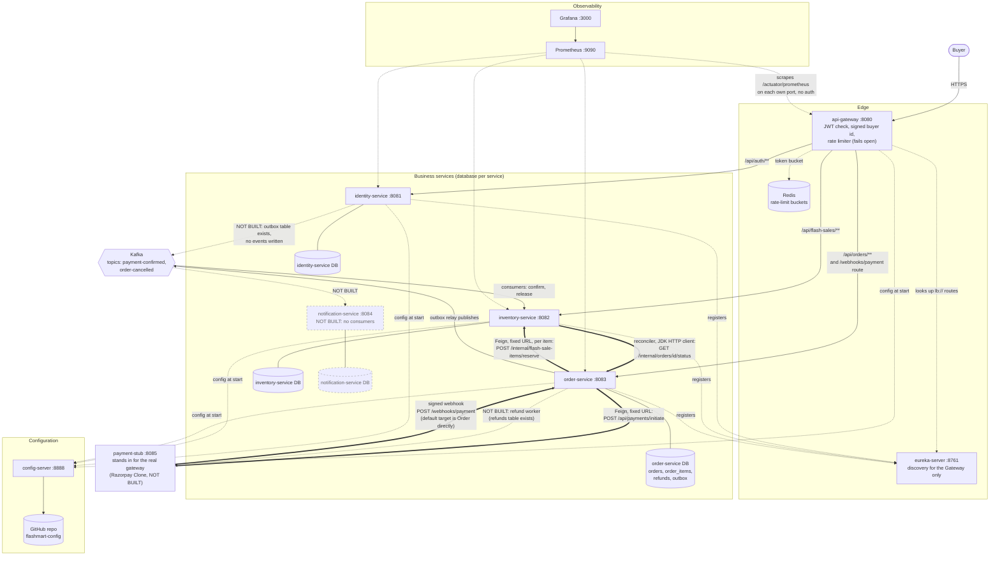
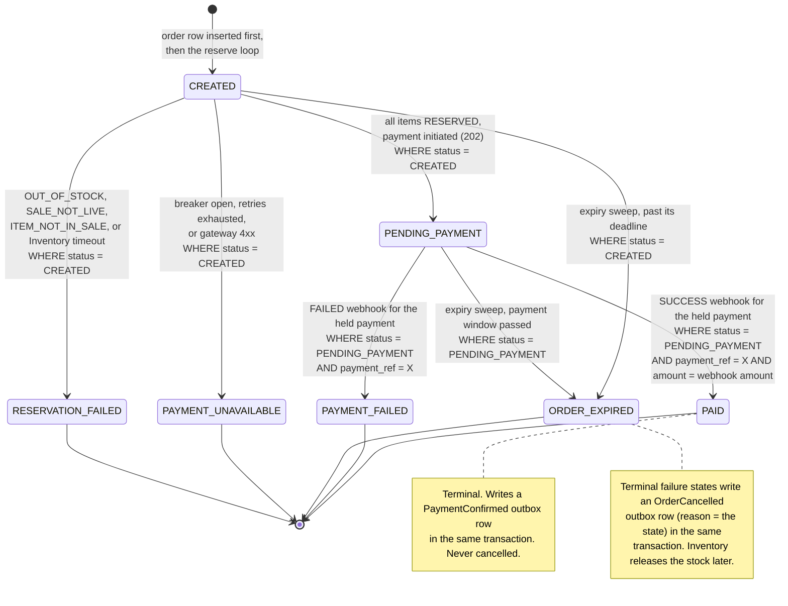
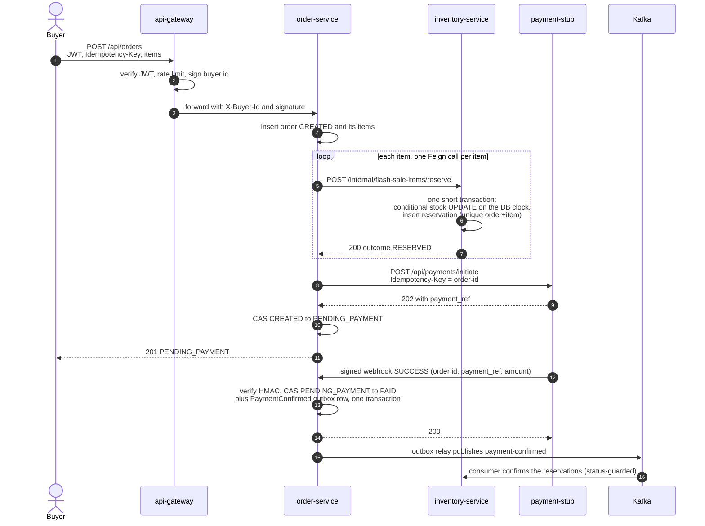
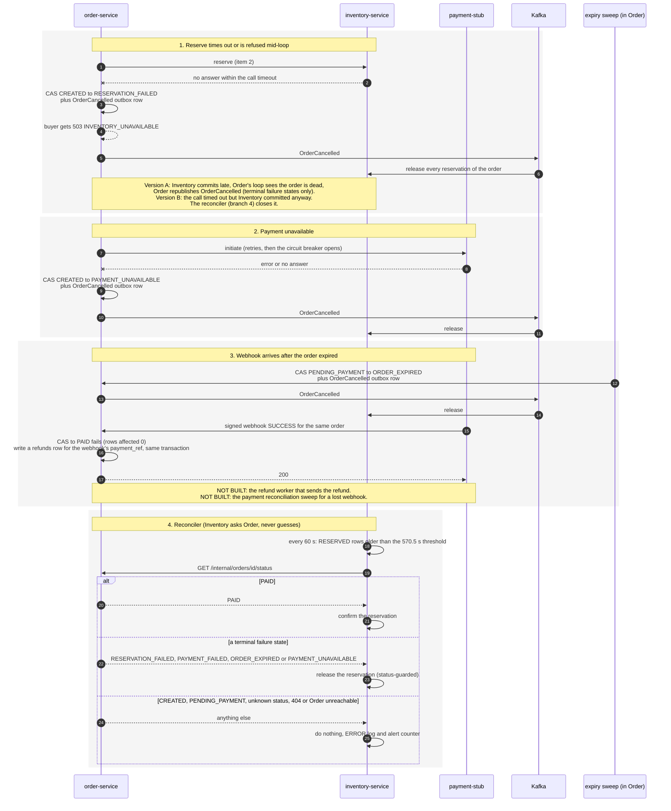

# Diagrams

Three diagrams: the architecture, the order state machine, and the purchase flow (happy path, then the failure branches). They were **derived from `architecture.md` sections 2, 3 and 6, then each arrow was checked against the code** (controllers, Feign clients, Kafka listeners, the `OrderStatus` enum and the six conditional `UPDATE` queries in `OrderRepository`, the Gateway routes, `monitoring/prometheus`). Where the code and the design differ, the diagram shows the code and says so.

**Legend.** A solid arrow is built. A **dashed grey box or dashed arrow marked "NOT BUILT"** is designed but not built. Nothing here has been checked by running it, apart from what `docs/testing.md` records for each piece.

Whether these Mermaid blocks render depends on your viewer (GitHub renders them). See the note at the end for what was and was not validated.

---

## (a) Architecture

Services, databases, Kafka, Redis and who calls whom. The thick split to remember: **everything under `/internal/**`, the payment initiate call, the metrics endpoints and Order's webhook default target are direct calls, never routed through the Gateway.**

How to read it:

- **Thick arrows are direct service-to-service calls.** Order's Feign clients use fixed URLs, not Eureka (the derived deadlines assume one attempt per call). Eureka is used by the Gateway only.
- **Nothing under `/internal/**` has a Gateway route** (checked in `api-gateway/src/main/resources/application.yml`; `ActuatorNotRoutedTest` pins `/internal` and actuator paths). The payment initiate call and the metrics endpoints are direct too.
- **The Gateway does have a `/webhooks/payment` route** (no JWT on it, the webhook has its own HMAC). The payment stub's default `ORDER_WEBHOOK_URL` skips the Gateway and posts straight to Order on `:8083`.
- **Config server values apply on restart.** Each client keeps a local fallback copy, so a config server that is down only costs a log line and a few seconds at start.
- **Not built:** Notification's Kafka consumers, Identity's events, the refund worker, the real payment gateway.

---

## (b) Order state machine

Seven statuses (`OrderStatus.java`): two transient, five terminal. **Every arrow is one `UPDATE orders SET status = ... WHERE id = ? AND status = <from state> ...` followed by a rows-affected check** (the six queries in `OrderRepository`). If the check returns 0 the caller lost the race and does nothing. Four writers race on this one row: the request thread, the expiry sweep, the webhook handler and the circuit-breaker path.

Things the diagram cannot show:

- **A late `SUCCESS` webhook for an order that is not `PENDING_PAYMENT`** (for example already `ORDER_EXPIRED`) does not change the status. Its CAS fails, and the handler writes a `refunds` row for the webhook's payment reference in the same transaction. The **refund worker that would send it is NOT BUILT.** An already-`PAID` order with the same `payment_ref` is a redelivery and is a no-op.
- **A webhook for an order still `CREATED`** is answered `409` with no write; the gateway's retry delivers it later.
- **`RESERVATION_RELEASED`** from Inventory makes Order stop without a CAS or event and report the real status.
- **`OrderCancelled` is never published for a `PAID` order.**

---

## (c) Purchase flow

### Happy path

### Failure branches

Each box is one branch. They run independently.

Notes on the failure branches:

- Branch 1 and the reconciler: Version A is implemented and tested; the reconciler is implemented, tested and was demonstrated once with the late reservation forced. How often Version B happens under real overload is not measured (`docs/testing.md`).
- Branch 3: the sweep and the webhook are raced in tests on real Postgres. The refund worker and the reconciliation sweep are designed (`architecture.md` section 6) and **not built**.
- The breaker, retry and deadline values are provisional and were checked against the stub, not a real gateway.

---

## Rendering

All four Mermaid blocks in this file (and the short one in the README) were rendered without errors by `npx @mermaid-js/mermaid-cli` on 2026-11-09. Only the architecture and state-machine renderings were looked at by eye; the two sequence diagrams were parsed and rendered but not inspected.
